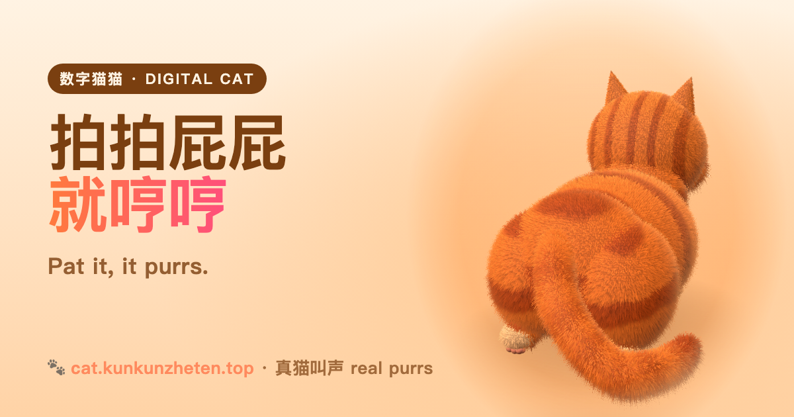

# 数字猫猫 · Digital Cat

**拍一下猫屁屁，30 秒班味清零。** 手机上的一只 3D 毛绒猫：拍拍它，它会抖毛、呼噜、回你一声喵。不用下载，不用登录。

**Pat the cat. Unwind in 30 seconds.** A fluffy 3D cat on your phone — pat it and it ruffles, purrs and meows back. No download, no sign-up.

▶ **https://cat.kunkunzheten.top**



## 怎么做的 · How it's made

- 猫在浏览器里实时渲染（[Three.js](https://threejs.org)，`src/main.js`），没有框架。 The cat is rendered live in the browser with Three.js — no framework.
- 拍打声和喵声是作者家猫的真实录音，呼噜来自 Wikimedia 公有领域录音，详见 [`audio/CREDITS.txt`](audio/CREDITS.txt)。 Pats and meows are recordings of the author's own cat; purrs are public-domain recordings.
- 托管在 Cloudflare Workers；`worker/index.js` 只处理打赏收银（Waffo）。 Hosted on Cloudflare Workers; the worker only handles the tip checkout.
- 不放追踪代码，见 [隐私说明](https://cat.kunkunzheten.top/privacy)；打赏可选、一次性，见 [条款](https://cat.kunkunzheten.top/terms)。 No trackers — see the privacy note; the tip is optional and one-time — see the terms.

## 本地运行 · Run locally

```sh
python3 -m http.server 8000   # 然后打开 / then open http://localhost:8000
```

改了 `src/main.js` 后用 esbuild 重新打包到 `dist/app.js`（命令见 `deploy.sh`）。 After editing `src/main.js`, rebuild `dist/app.js` with esbuild (see `deploy.sh`).

## 作者 · Author

Kun，和一群 AI 编程搭档一起做的。问题或建议请提 Issue，或写信到 hello@deararcana.com。 Made by Kun with a crew of AI coding partners. Questions or ideas: open an issue or email hello@deararcana.com.

代码与录音版权归作者所有，未经许可请勿商用；Three.js 遵循其 MIT 许可（`vendor/three-LICENSE`）。 Code and recordings © Kun, all rights reserved; Three.js is MIT-licensed.
